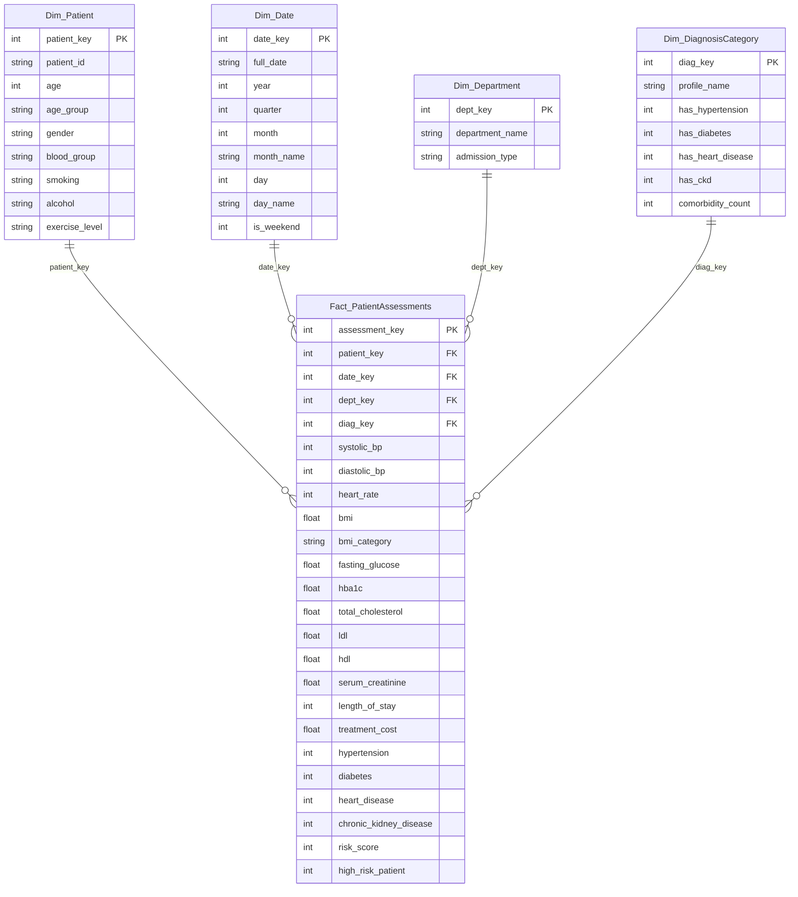
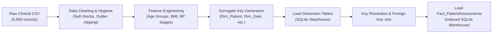

# 🩺 HealthPulse: Clinical Data Warehouse & Predictive Mining System
> **Academic Minor Project for Data Warehousing & Data Mining (DWM)**  
> **Course / Subject:** Data Warehousing and Data Mining (CS / IT / AI-DS)  
> **Technology Stack:** Python 3.13, Streamlit, SQLite, Scikit-Learn, Plotly, MLxtend, Pandas, NumPy

---

## 📖 Executive Summary & Objectives
Modern healthcare facilities generate massive volumes of clinical, biochemical, and demographic patient records. Traditional transactional database systems (OLTP) are optimized for transactional entry but struggle with multidimensional analytical queries and epidemiological pattern discovery.

**HealthPulse** addresses this challenge through an end-to-end Data Warehousing and Data Mining (DWM) architecture:
1. **Clinical Data Warehouse (Star Schema):** Designs a centralized dimensional repository separating clinical metrics (Fact table) from descriptive entities (Dimension tables).
2. **Online Analytical Processing (OLAP):** Implements multi-dimensional operators (**Roll-up, Drill-down, Slice, Dice, Pivot**) to evaluate treatment expenditures, length of stay, and disease prevalence.
3. **Supervised Data Mining (Classification):** Evaluates multi-disease prediction using **CART Decision Trees, Random Forest, Gaussian Naïve Bayes, and Logistic Regression**.
4. **Unsupervised Data Mining (Clustering):** Performs patient risk cohort stratification using **K-Means Clustering**, validated with the **Elbow Method** and **Silhouette Analysis**.
5. **Association Rule Mining:** Mines frequent symptom-disease co-occurrences and comorbidity itemsets using the **Apriori Algorithm** (measuring Support, Confidence, and Lift).
6. **Interactive Streamlit Web Dashboard:** Delivers an intuitive graphical interface for hospital administrators and clinicians with instant diagnostic inference and printable audit reports.

---

## 🏛️ Dimensional Data Warehouse Architecture (Star Schema)

The data warehouse uses a **Star Schema** with one central Fact Table connected to four Dimension Tables via surrogate foreign keys:



### Table Dictionary & Granularity
- **Fact Table (`Fact_PatientAssessments`)**:
  - **Grain:** One row per individual patient assessment session.
  - **Measures (Additive/Semi-additive):** `treatment_cost`, `length_of_stay`, `risk_score`, `systolic_bp`, `fasting_glucose`, `total_cholesterol`, `serum_creatinine`.
- **Dimension Tables:**
  - `Dim_Patient`: Conformed demographic attributes and lifestyle risk variables.
  - `Dim_Date`: Temporal dimension enabling roll-up/drill-down across calendar hierarchies (Year $\rightarrow$ Quarter $\rightarrow$ Month $\rightarrow$ Day).
  - `Dim_Department`: Hospital administrative unit and admission classification (Inpatient, Outpatient, Emergency).
  - `Dim_DiagnosisCategory`: Comorbidity profiles and disease combinations.

---

## 🔄 ETL (Extract, Transform, Load) Pipeline



1. **Extract:** Ingests raw transactional CSV data containing demographic and clinical vitals.
2. **Transform:**
   - Categorizes numeric ages into standardized epidemiological cohorts:
     - *Young Adult (18-29), Adult (30-44), Middle-Aged (45-59), Senior (60-74), Elderly (75+)*.
   - Categorizes BMI based on WHO standards:
     - *Underweight (<18.5), Normal (18.5-24.9), Overweight (25-29.9), Obese (>=30)*.
   - Decomposes timestamps into Year, Quarter, Month, Day, and Weekend flags.
   - Resolves natural identifiers into sequential surrogate integer keys.
3. **Load:** Executes transactional insertions (`ACID` compliant) with foreign key checks and creates B-Tree indexes for fast OLAP slice-and-dice aggregations.

---

## 🧊 OLAP Operations Implementation

The system implements all five core OLAP operations:

| Operation | Academic Definition | Implementation in Project |
| :--- | :--- | :--- |
| **Roll-Up** | Aggregates data by climbing up a dimensional hierarchy (coarser grain). | Month $\rightarrow$ Quarter $\rightarrow$ Year summaries of disease cases, costs, and length of stay. |
| **Drill-Down** | Splits aggregated measures into detailed components (finer grain). | Hospital Unit $\rightarrow$ Admission Type (Inpatient/Outpatient/Emergency); or Age Group $\rightarrow$ Gender. |
| **Slice** | Selects a 2D sub-cube by fixing a single dimension. | Slices data cube for a specific department (e.g., `Department = 'Cardiology'`). |
| **Dice** | Extracts a sub-cube by filtering two or more dimensions simultaneously. | Filtering `Department IN ('Cardiology', 'Nephrology')` AND `AgeGroup IN ('Senior', 'Elderly')`. |
| **Pivot** | Rotates the dimensional view to create cross-tabulated matrix heatmaps. | 2D Matrix of Age Groups vs. Hospital Departments displaying Mean Treatment Cost or Mean Risk Score. |

---

## 🧠 Data Mining Algorithms & Methodologies

### 1. Supervised Classification (Disease Risk Prediction)
Trains and compares four diverse machine learning classifiers to predict disease onset (Cardiovascular Disease, Diabetes, Chronic Kidney Disease):
- **Decision Tree (CART):** Generates transparent, human-interpretable if-then decision paths based on Gini impurity.
- **Random Forest:** Ensemble of 100 bagging decision trees that mitigates overfitting and outputs clinical feature importances.
- **Gaussian Naïve Bayes:** Probabilistic classification based on Bayes' Theorem under feature conditional independence.
- **Logistic Regression:** Linear decision boundary model with sigmoid link function serving as an epidemiological baseline.

**Evaluation Metrics:**
$$\text{Accuracy} = \frac{TP + TN}{TP + TN + FP + FN}, \quad \text{Precision} = \frac{TP}{TP + FP}, \quad \text{Recall} = \frac{TP}{TP + FN}$$
$$\text{F1-Score} = 2 \times \frac{\text{Precision} \times \text{Recall}}{\text{Precision} + \text{Recall}}, \quad \text{ROC-AUC} = \int_{0}^{1} \text{TPR}(FPR) \, d(FPR)$$

### 2. Unsupervised Clustering (Patient Risk Stratification)
- **Algorithm:** K-Means with Euclidean metric on standardized vitals ($Z$-score normalized).
- **Cluster Validation:**
  - **Elbow Method:** Plots within-cluster sum of squares (Inertia) across $K \in [2, 7]$ to identify the point of diminishing returns.
  - **Silhouette Coefficient:** Quantifies separation distance between clusters ($s \in [-1, 1]$).
- **Dimensionality Reduction:** 2D and 3D Principal Component Analysis (PCA) to visualize high-dimensional health clusters.

### 3. Association Rule Mining (Comorbidity Discovery)
- **Algorithm:** Apriori algorithm with frequent itemset generation based on the Apriori downward-closure property.
- **Metrics Calculated:**
  - $\text{Support}(A \Rightarrow B) = P(A \cup B)$
  - $\text{Confidence}(A \Rightarrow B) = \frac{P(A \cup B)}{P(A)}$
  - $\text{Lift}(A \Rightarrow B) = \frac{P(A \cup B)}{P(A) \cdot P(B)}$
  - *(A Lift > 1.0 indicates a statistically significant positive medical association between symptoms and diagnosis).*

---

## 📁 Project Directory Structure

```
dwm_healthcare_project/
├── app.py                          # Streamlit Multi-Page Interactive Dashboard
├── requirements.txt                # Python package dependencies
├── run_app.bat                     # Windows 1-Click Launch Script
├── test_project.py                 # Automated Unit & Integration Test Suite (8/8 Passing)
├── README.md                       # Comprehensive Documentation & Viva Guide
├── data/
│   ├── raw/
│   │   └── raw_healthcare_data.csv # 3,500 Raw Clinical Patient Records
│   └── warehouse/
│       └── healthcare_dw.db        # SQLite Star Schema Warehouse
└── src/
    ├── __init__.py
    ├── dataset_generator.py        # Generates realistic clinical dataset
    ├── warehouse.py                # Star Schema DDL, Connections, and OLAP functions
    ├── etl.py                      # Extract-Transform-Load Pipeline
    └── mining_models.py            # Classification, Clustering, and Apriori Miners
```

---

## 🚀 Setup & Execution Guide

### Prerequisites
- Python 3.9 or higher (tested on Python 3.13)
- Windows PowerShell / Command Prompt / Terminal

### Step 1: Install Dependencies
```bash
cd dwm_healthcare_project
python -m pip install -r requirements.txt
```

### Step 2: Run Automated Tests
Verify that the database, ETL pipeline, and all data mining models pass:
```bash
python test_project.py
```
*(All 8 test suites should pass with `OK`)*.

### Step 3: Launch the Interactive Web Application
You can launch directly with Python:
```bash
python -m streamlit run app.py
```
Or double-click the **`run_app.bat`** file in Windows Explorer.

The application will start automatically in your browser at:
👉 **`http://localhost:8501`**

---

## 🎓 Viva Voce / Oral Examination Preparation (Q&A)

Here are the most common questions external examiners ask during a DWM project viva, along with model answers:

### 1. What is the difference between OLTP and OLAP in your project?
> **Answer:** OLTP (Online Transaction Processing) systems handle day-to-day atomic operations such as registering a new patient or updating a lab result with normalized (3NF) tables. OLAP (Online Analytical Processing) is designed for multi-dimensional querying, aggregations, and decision support over historical data using a denormalized Star Schema with pre-aggregated measures.

### 2. Why did you choose a Star Schema over a Snowflake Schema?
> **Answer:** In a Star Schema, dimension tables are completely denormalized, meaning each dimension is represented by a single flat table directly joined to the central fact table. This minimizes SQL join operations, simplifies OLAP queries (Roll-up, Slice, Dice), and delivers significantly faster query response times than a normalized Snowflake Schema.

### 3. What is the Grain of your Fact Table?
> **Answer:** The grain is the fundamental level of detail stored in the fact table. In our system, the grain is **one record per clinical patient assessment**, recording their exact vital signs, laboratory measurements, diagnosis flags, and treatment cost at that specific point in time.

### 4. What is the Apriori Property (Downward-Closure Property)?
> **Answer:** The Apriori property states that *all non-empty subsets of a frequent itemset must also be frequent*. If an itemset is infrequent, all of its supersets will also be infrequent and can be pruned immediately, drastically reducing the search space during association rule mining.

### 5. What does a Lift value greater than 1.0 signify in Association Rules?
> **Answer:** Lift measures the ratio of the observed co-occurrence of itemset $A$ and $B$ to the expected co-occurrence if $A$ and $B$ were statistically independent. A Lift $> 1.0$ indicates that the occurrence of condition $A$ significantly increases the likelihood of condition $B$ occurring (e.g., Lift = 4.2 means patients with High Blood Pressure and High Blood Sugar are 4.2 times more likely to suffer from Heart Disease than average).

### 6. How did you validate the optimal number of clusters in K-Means?
> **Answer:** We utilized two complementary validation techniques:
> 1. **The Elbow Method:** Plotted within-cluster inertia vs. $K$ to identify the inflection point.
> 2. **Silhouette Analysis:** Evaluated the silhouette coefficient to confirm that cluster cohesion within clusters is maximized while separation between distinct risk cohorts is preserved.

---

## 👨‍💻 Project Authors & Attribution
- **Project Domain:** Healthcare Informatics, Data Warehousing, and Predictive Data Mining
- **Implementation:** Python 3.13, Streamlit, Scikit-Learn, SQLite, Plotly
- **License:** Educational Academic Use

## Role-Based Dashboards

The latest version includes role-based access:

- **Admin Dashboard**: warehouse KPIs, disease/department charts, user management, account activation/deactivation, and all existing DWM modules.
- **User Dashboard**: profile, personal health assessment, disease-risk predictions, treatment-cost estimation, latest results, and assessment history.

### Demo Accounts

- Admin: `admin` / `admin123`
- User: `user` / `user123`

These are demonstration credentials only. Do not use them for real healthcare data.


## Authentication and Roles
- Registration creates standard user accounts only.
- Admin and user accounts land on their respective dashboards after login.
- Each account has a My Profile page and password-change flow.
- Admins can view all non-sensitive user profile fields and export all saved assessment results to Excel.
- Users can view their own profile, assessments, and export their own saved results to Excel.
- Passwords are stored as salted PBKDF2-HMAC-SHA256 hashes; password hashes are never shown in profiles or Excel exports.
